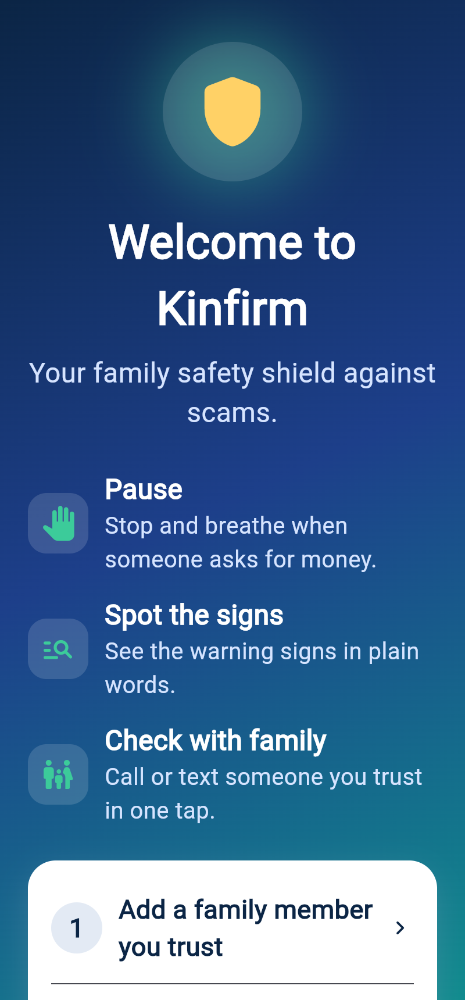
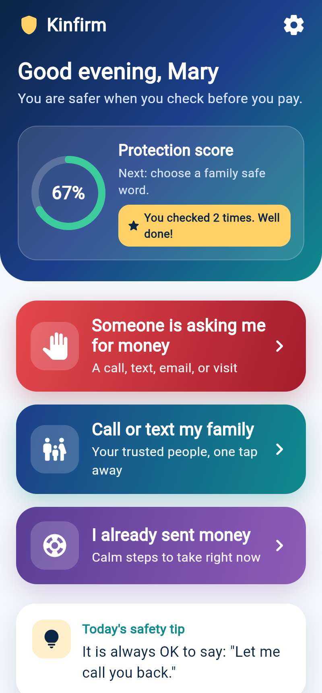
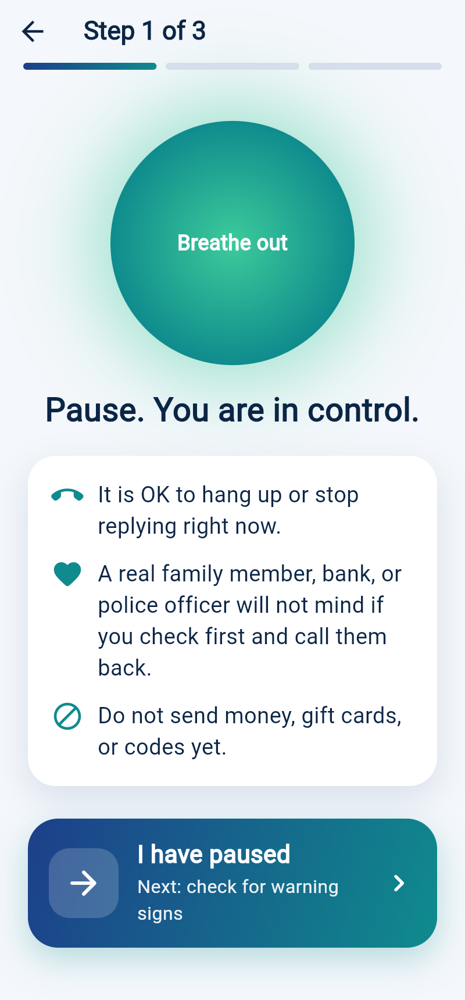
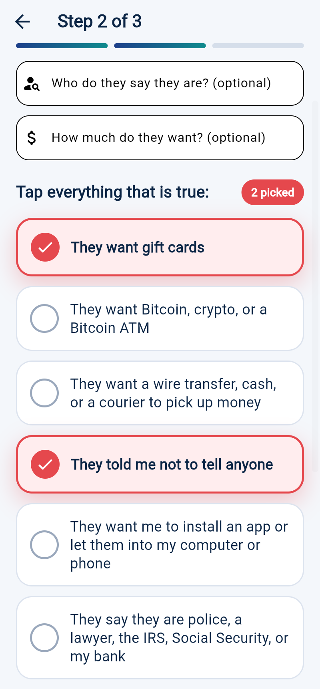
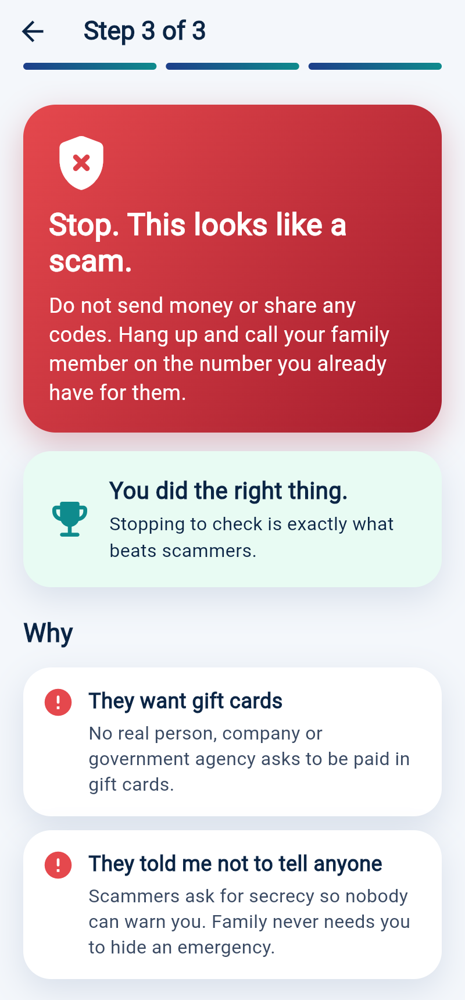
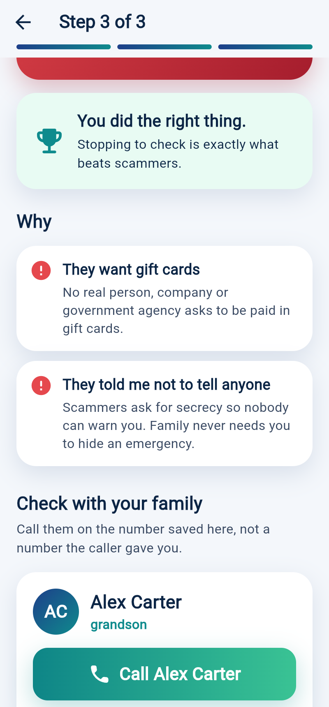

# Kinfirm: check before you pay

*Working name. Easy to change before launch.*

A simple app for older adults (and the grandchildren who set it up for them).
When someone calls, texts or emails asking for money, the app helps them
**pause, spot the warning signs, and check with family before paying**.

| Welcome | Home | Pause & breathe |
|---|---|---|
|  |  |  |

| Warning signs | Result | Check with family |
|---|---|---|
|  |  |  |

## What version 1 does

- **"Someone is asking me for money" flow**
  1. Pause: tells them it's OK to hang up.
  2. Tick the warning signs (gift cards, crypto, wire, secrecy, "police", a
     relative in jail, urgency, codes, remote access...).
  3. Result: *Stop, this looks like a scam*, *Be careful*, or *No warning
     signs picked, but still check*. The app **never says "safe"**.
- **Check with family**: one tap to call a saved family member, or to text
  them a pre-written *"Is this really you?"* message that includes who the
  caller claimed to be, the amount, and the warning signs.
- **Family safe word**: stored in the phone's secure storage; the app reminds
  them to ask for it but never shows it unless they tap to reveal.
- **"I already sent money"**: steps for each payment type (gift card, bank,
  wire, crypto, Zelle/Venmo/Cash App, cash, gave a code) plus links to report
  to the FTC and FBI, and the free AARP Fraud Watch helpline.
- **Encouraging design**: a greeting, a **protection score** ring that fills
  as the family finishes setup, a **"You checked N times. Well done!"**
  badge, a calming **breathing guide**, "You did the right thing" praise on
  every result, and a daily safety tip. Gentle animations throughout, turned
  off automatically when the phone's "reduce motion" setting is on.
- **Built for older eyes**: large text (adjustable up to 200%), big buttons,
  high contrast, screen-reader labels.
- **Private**: no account, no server, no SMS or call-log permissions.
  Everything stays on the phone.

## Run it

Requires the [Flutter SDK](https://docs.flutter.dev/get-started/install)
(3.50 or newer).

```bash
flutter pub get
```

```bash
flutter test
```

```bash
flutter run
```

To build for Play Store: `flutter build appbundle` (needs the Android SDK).

## Project layout

```
lib/
  logic/red_flags.dart      warning signs + risk scoring (never "safe")
  logic/verify_message.dart the "Is this really you?" text, tel/sms links
  logic/already_paid.dart   what to do after paying, by payment method
  data/                     contacts, safe word, settings (on-device)
  screens/                  home, pause flow, family, setup, onboarding
test/                       unit tests + full-flow widget tests
```

## Why this idea (research, Nov 2026)

- FBI IC3 2025: people 60+ reported **$7.75B** in losses (up 59%), with
  12,400+ losing $100k or more each.
- AI-related scam losses: about **$893M** in 2025; voice cloning makes the
  "grandparent in trouble" call much more convincing.
- The FBI and FCC recommend a **family safe word** and **hanging up and
  calling the relative directly**. This app turns that advice into a button.

**Competition (honest):** apps such as MailShield Guardian, KinShield,
Kinguard, SeniorShield, Aura, Carefull and EverSafe already exist. Most are
AI message scanners or bank monitoring, and several are paid-only. Kinfirm's
angle is the **moment of decision**: pause, ask family, safe word, all free,
simple and private. Daily check-in apps (Snug and many "Are You Dead?"
copies) are already crowded, so that's a later add-on, not the core.

## Roadmap

1. **Now:** test with 10-20 real families. Watch a grandparent use it
   without help. Fix anything confusing.
2. **Two-way family alerts:** a family app + backend (e.g. Firebase) so
   the grandchild gets a push and can answer "Yes it's me / No, it's a scam"
   with one tap.
3. **AI "check this message":** share a screenshot or text; plain-English
   explanation of the risk (never "this is safe").
4. **Optional daily "I'm OK" check-in.**
5. Spanish language, iOS release, a family plan ($3.99-4.99/month) for the
   AI and alert features; the core pause flow stays free.

## Before publishing

- Pick the final name and check the trademark/app-store names.
- Privacy policy + Play Store Data safety form (easy: no data leaves the
  phone in v1).
- New personal Play Console accounts must run a closed test (about 12
  testers for 14 days) before going public.
- Have someone review the scam/help wording; the app gives guidance, not
  legal or financial advice.
